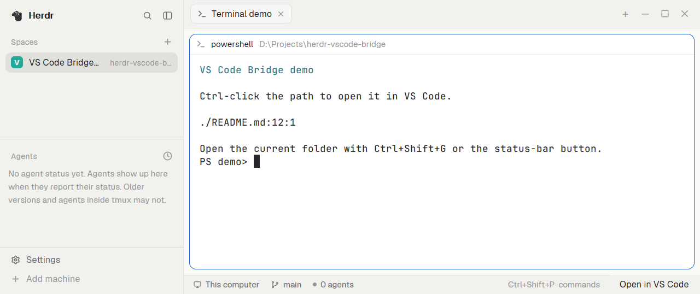

# Herdr VS Code Bridge

[简体中文](README.zh-CN.md)

Click **Open in VS Code** or press **Ctrl+Shift+G** in Herdr Desktop to open the focused terminal's working directory. If the terminal has no reported directory, the bridge uses the active space's folder. You can also run **Open in VS Code** from the command palette.

**Ctrl-click** a terminal file link to open it in VS Code with the line and column detected by Herdr, for example `./src/main.js:12:4`. On macOS, use Cmd-click. On Windows, the bridge attempts to activate the selected editor window. If Windows blocks keyboard focus, it attempts to show the matching window above Herdr. [Windows foreground behavior (Chinese)](docs/windows-foreground.md)



## Install on Windows

You need Herdr Desktop with `link_handlers` support (tested on 0.1.18) and a local VS Code installation. For remote work, install Microsoft's WSL or Remote - SSH extension in your local VS Code.

Open Herdr and run this command from the repository:

```powershell
.\Install.ps1 -Activate
```

If `herdr-app` is missing from PATH, pass `-HerdrApp 'C:\path\to\herdr-app.exe'`. The installer copies the shipped `main` layout to `main-vscode-bridge`, adds the button and file link handler, and binds the shortcut in that layout. Omit `-Activate` to switch layouts later from Settings. English is the default. Pass `-Language zh-CN` for the Chinese interface.

## Install or update manually

1. Copy `mods/vscode-bridge` to `mods/` in your Herdr app home. The default is `~/.config/herdr-app`. You can set `HERDR_APP_HOME` to use a different location. When updating, keep any local `authorities.json` and `locale.json`.
2. From the command palette, clone the shipped `main` layout as `main-vscode-bridge`. Add `"link_handlers": ["vscode-bridge"]` to the root of the copy. If the field already exists, append the mod name to the list.
3. Add the button block to a row or column in the new layout. This example fits at the bottom of a column.

   ```json
   {
     "id": "vscode-bridge",
     "type": "block",
     "size": { "px": 28 },
     "content": { "mod": "vscode-bridge" }
   }
   ```

4. Merge the shortcut into `keys.json` and switch to the new layout. On macOS, you can use `cmd-shift-g`.

   ```json
   {
     "layout:main-vscode-bridge": {
       "ctrl-shift-g": "mod.open:vscode-bridge"
     }
   }
   ```

5. Run `herdr-app check <app-home>/mods/vscode-bridge` and use `herdr-app status` to check for runtime errors.

To switch the interface to Simplified Chinese, create `locale.json` in the installed mod directory with `{"language":"zh-CN"}`. The command palette entry remains **Open in VS Code**.

## Machines and workspaces

| Terminal source | VS Code target |
| --- | --- |
| Local Windows | Local filesystem |
| WSL2 on the same Windows computer | Native `wsl+` authority when exactly one running distribution matches the terminal's Linux boot ID and machine ID |
| A Herdr machine connected over SSH | `ssh-remote+` authority from the SSH target registered in Herdr |

Connect WSL2 or SSH as a separate Herdr machine. When you run `wsl` or `ssh` inside a local terminal, the Herdr Mod API can still report that terminal as local.

If WSL detection fails, you use a custom `--via` transport, or VS Code needs a different SSH alias, create `authorities.json` in the installed mod directory. Each key names a Herdr machine and its value supplies the WSL distribution or the SSH alias that VS Code can use.

```json
{
  "my-wsl-machine": { "wsl": "Ubuntu" },
  "my-ssh-machine": { "ssh": "my-server" }
}
```

VS Code selects a window using the remote authority, resource path, and its window settings. It can reuse an existing matching workspace. The bridge encodes paths as URIs, including spaces and Unicode. For paths with spaces that Herdr does not detect as a single link, the terminal application can emit an OSC 8 `file:` link. Herdr 0.1.18 provides no coordinates for `file:` links and skips some plain filenames and backslash paths.

The mod runs in the Herdr interface and needs no background service or additional runtime dependency. It leaves agent prompts and skills untouched.

## Development checks

With Node.js 22.7 or later, run `node --test tests/paths.test.mjs` to check path encoding, diagnostic coordinates, remote authorities, and language messages. Run `herdr-app check mods/vscode-bridge` to validate the manifest and initial view.

- [Herdr Mod developer guide](https://github.com/herdrdev/herdr-app/blob/v0.1.18/defaults/AGENTS.md)
- [VS Code CLI](https://code.visualstudio.com/docs/configure/command-line)
- [VS Code Remote SSH URIs](https://code.visualstudio.com/docs/remote/troubleshooting#_connect-to-a-remote-host-from-the-terminal)
