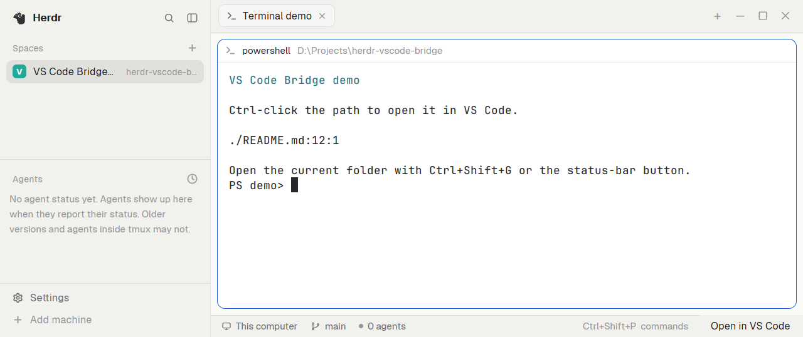

# VS Code Bridge

[English](RECIPE.md)

在当前终端目录工作时，点击底部的 **用 VS Code 打开**，或按 **Ctrl+Shift+G**，可以在对应的本地、WSL 或 SSH 工作区打开目录。Ctrl+点击终端文件链接会在 VS Code 跳到 Herdr 识别出的行列。

Mod 由一个按钮视图、一个文件链接处理器和共享的启动逻辑组成。Windows 安装脚本以官方 `main` 为基底创建独立布局。其他布局也可以引用同一个 Mod。安装方式、中文界面、远程映射和链接识别边界见 [中文 README](README.zh-CN.md)。

安装完成后，应能在新布局看到按钮，用快捷键打开当前目录，并通过终端文件链接跳到指定位置。
